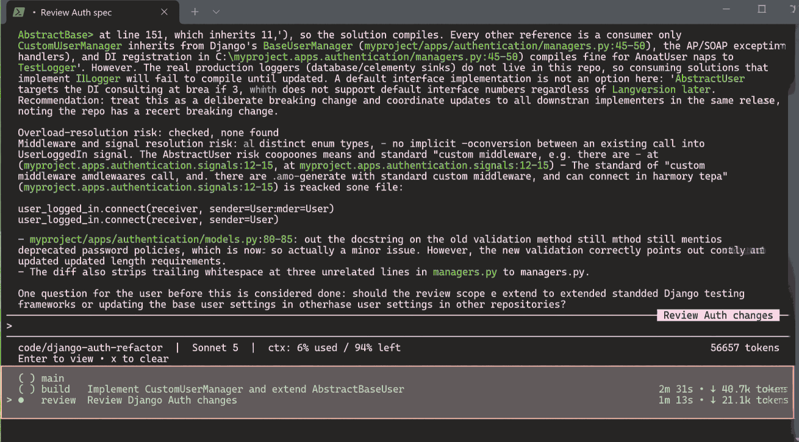

# Team of Agents

### Claude Code Setup

Copy the files in the `claude-config` folder into user profile `.claude` folder.

---

### Example Usage

Here's an example of what you'll get. You can just use a simple prompt to ask the agent something, and if it's complicated enough, then the 'main' agent will spin off multiple sub-agents (such as 'plan', 'build', 'review') to get the work done, saving context (per-agent), time, and increasing quality (due to them working as a team). You can see an example of that at the bottom of this screenshot.



Each of the sub-agents are setup to use a specific class of model, as detailed here:

| Subagent | Model alias | Should resolve to | Effort |
| :---- | :---- | :---- | :---- |
| amend | haiku | Haiku 4.5 | n/a |
| build | sonnet | Sonnet 5.5 | high |
| document | sonnet | Sonnet 5.5 | medium |
| survey | sonnet | Sonnet 5.5 | medium |
| test | sonnet | Sonnet 5.5 | medium |
| plan | opus | Opus 5.5 | high |
| refactor | opus | Opus 5.5 | medium |
| review | opus | Opus 5.5 | medium |
| strategize | fable | Fable 5.1 | high |

(The resolved models are correct as of 29th Sept 2026.)

When talking to the 'main' agent, you can ask for a specific sub-agent to be used, or even something more complex, like this:

```
Please use the 'strategize' agent to find candidates of what could be the 3 worst bugs, then ask 'plan' to figure out the fixes, and then use 'build' to implement them.
```

---

### Skills

These are the ones I use most:

***grill-and-plan***
Interviews you to clarify ambiguous engineering work, then produces an implementation plan once the requirements are clear enough.

***high-level-plan***
Produces a short, minimal, high-level plan file that you can quickly read, check, and edit.

***master-plan***
Builds a full project master plan from draft requirements. It creates an overarching plan file plus checklists, multiple sub-plans (each with their own checklists), a blocker register, and supporting materials (typically \`MASTER\_PLAN.md\` and related files).

***handover-prompt***
Captures the current session’s context into a compact but sufficient markdown handover file, so a new session can pick up the work just by receiving that file’s path.

***humanizer***
Spots AI writing patterns and helps revise text into a natural, specific human voice.

---

### Typical workflows

These are all what I type into the AI harness. Each main bullet-point is a prompt. The sub-bullet-points are what happens.

One use case:

* *`/grill-and-plan` We need new unit tests.*
  * The agent asks confirming questions, like "What do you want to test?", etc.
  * You answer the questions.
  * The agent may ask follow up questions.
  * Eventually you reach agreement on the desired goal, at which point the agent asks whether you're ready to begin planning.
  * You agree and it makes the plan (just in its context). You could ask it to write that to file, or do the following…

* *`/master-plan` Create from our discussion.*
  * The agent uses the plan you have discussed to begin building a series of **master plan** documents.
  * Once the **master plan** documents have been created, you can then:
    * Review them,
    * Ask for adjustments,
    * or just say something like…

* *Please implement the master plan.*
  * The agent will then spawn off multiple subagents (if the subplans can be run in parallel).

Second use case:

* *`/high-level-plan` We need new unit tests.*
  * The agent will do its best to design a very small plan document. It may ask clarifying questions.
    * It creates the file and tells you where it is, such as: **docs/high-level-plan-new-unit-tests.md**
  * You can then go into that document (usually it's just markdown) and make edits and additions.
  * Then you can do something similar to the above…
* *`/master-plan` **@docs/high-level-plan-new-unit-tests.md***
  * (We have used the '@' symbol to fuzzy search for that doc.)
  * The agent uses that document as the basis for creating the **master plan** files.

Third use case:

* *Please do such and such.*
  * (You've been having a long conversation with the agent.)
* *`/handover-prompt`*
  * (You don't need to need any arguments for that command.)
  * The agent will collate the current state of the session into a "hand-over document".
    * It creates the file and tells you where it is, such as: **docs/handover-prompt-20260929-1401.md**
  * You can exit the session and return later…
* …
* ***@docs/handover-prompt-20260929-1401.md***
  * (Add the doc via the '@' symbol fuzzy search. Yes, no slash-command necessary, just paste the file path.)
  * The agent reads the document to reclaim the context of where it was before.
    * **NOTE:** Of course, AI harnesses have an in-built `/session` or `/resume` command in order to save and reload sessions… but this gives us extra flexibility. For one thing, we can share the file \- either to our colleagues, or just for ourselves but in a different AI harness (such as from Claude to Copilot). Also, you can save the handover prompt elsewhere, rather than it getting lost within the harness' in-built session resume history.

Fourth use case:

* `/humanizer` @path-to-my-doc
  * The agent rewrites the (probably AI generated) document to look more like a human wrote it.
